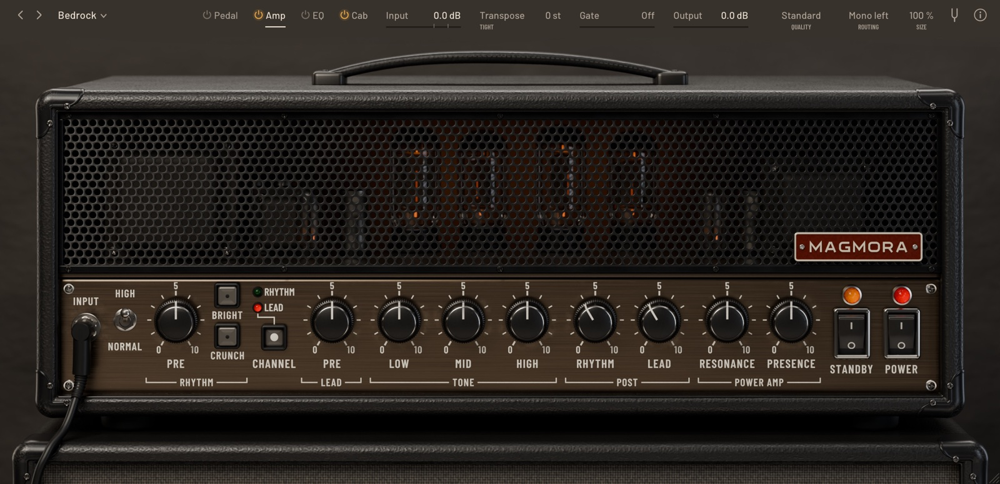
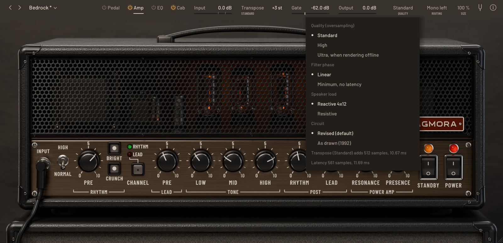
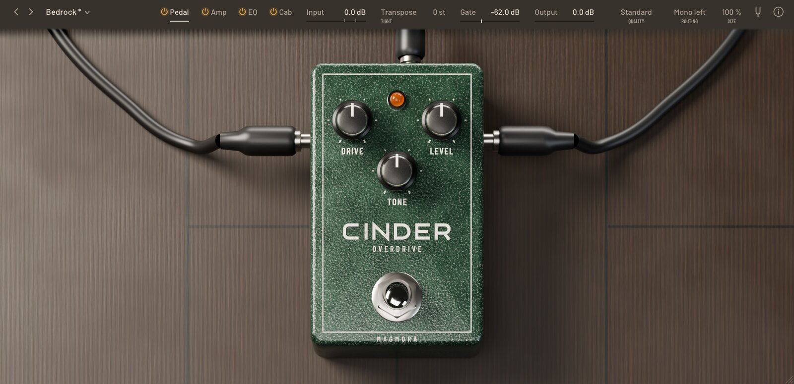

# Magmora

Magmora is an open-source guitar amplifier head for your DAW: an AU, VST3 and stand-alone plug-in for macOS
whose sound comes from solving the circuit of a two-channel, 120 watt, all-valve high-gain head of the early
1990s in real time. Five 12AX7s, four 6L6GCs, the output transformer, a reactive speaker load and the power
supply are simulated as a circuit, not approximated by filters and waveshapers. The cabinet section plays a
built-in modelled cabinet by default, or your own pack or impulse response files; no cabinet recordings are included.



The circuit studied is a 1992 120 W high-gain head with the block-letter logo ("the reference head"), from the
manufacturer's published service drawings. Magmora is an independent project. It is not affiliated with, endorsed
by or connected to the maker of that head or any other amplifier maker, and its name, panel and artwork are its own.

## How good is it?

- **Against SPICE.** The circuit solver is checked against ngspice running the same netlist with identical device
  laws: DC operating points, small-signal responses, harmonics and transients on every channel. It passes all but a
  few cases, which are listed with their numbers in [docs/VERIFICATION.md](docs/VERIFICATION.md).
- **Against real amplifiers.** The model was compared with two neural captures of real block-letter heads, with only
  the controls a player has (knobs, switches and input gain) fitted. It follows them closely but not in every detail:
  some frequency bands miss their targets, and the differences are listed in VERIFICATION.md. The captures are private
  and the comparison is not part of this repository.
- **The default voicing ("Revised")** changes three values of the lead path to those of the manufacturer's later
  drawing, which fit both captures much better than the 1992 values. A filter ahead of each captured amp explains the
  data about as well, so this choice is provisional, and "As drawn (1992)" can be chosen
  per instance ([docs/MODEL.md](docs/MODEL.md) section 2).

## What you get

- Both channels with every control of the original: Rhythm pre-gain, Bright and Crunch, Lead pre-gain, Low,
  Mid, High, Rhythm and Lead post-gain, Resonance, Presence, Standby, Power, the High and Normal inputs.
- An input trim, a simple noise gate, an output level and meters in a slim bar above the amp.
- Three qualities: Standard (six times oversampled at 44.1 and 48 kHz), High (twice that), and Ultra, which is
  used only when the host renders offline; in real time Ultra plays at High.
- Two circuit value sets: Revised (default) and As drawn (1992), saved with the session.
- Mono, mono-to-stereo and stereo (left only, summed, or two independent amps).
- Reported latency: 49 samples at 48 kHz in Standard, or zero with minimum-phase filters.
- **Cinder**, an overdrive pedal in front of the amp, solved as a circuit like the head: the classic 1979 green
  overdrive design (op-amp gain stage with diodes in its feedback, then a tone stage), with Drive, Tone and Level.
  Off until switched on (see [The pedal](#the-pedal)).
- Around the amp, each on its own page: a four-band EQ with high-pass and low-pass after it (off until switched on),
  and a cabinet with two slots summed in parallel (on in a new instance). Each slot
  plays a virtual microphone placed on a cabinet pack, or your own impulse response file, with its own level, pan
  and phase. The pack is the built-in **Trad 4x12 (modelled)** with a 57-type microphone until you choose a folder
  of your own pack (Pack button on the cabinet page).
- Every section can be switched off from any page: each tab in the bar (Pedal, Amp, EQ, Cab) has a small power
  toggle left of its name, lit while that section is on; the name itself opens the page. With the Amp off, the signal
  goes pedal, EQ, cabinet at unity (the input trim, gate and output level still apply), at the same latency and
  without the amp's CPU cost, so Magmora can be a pedal alone, a head into an external cabinet tool (Cab off), or a
  cabinet after another amp. The head's switch is the automatable parameter "Amp"; sessions and presets from before
  it load with the head on.
- 19 factory presets, level-matched to the default through the built-in cabinet; three of them set the pedal and EQ
  too, and none needs a pack or a file. Your own presets are saved, renamed, deleted and imported from the same menu
  (see [Presets](#presets)).
- A chromatic tuner in the plug-in and the stand-alone app, A4 from 430 to 450 Hz, down to a 7-string's low A
  (see [Tuner](#tuner)).
- A pitch transposer at the input, -12 to +12 semitones in the bar, made to be played through: 5.3 ms of added
  latency (Tight) or 10.7 ms (Standard), and none at all at 0 st, where it is out of the signal (see
  [Transpose](#transpose)).
- Clip marks on the Input and Output meters, a target band on the Input meter, and a hint line that names the control
  under the pointer, its value and what it does.
- About 25 % of one Apple M4 Pro performance core at 48 kHz, Standard, 64-sample blocks, as a new instance plays
  (with the built-in cabinet); about 30 % with the pedal, the EQ and both cabinet microphones on.



## Using Magmora

### The bar

Left to right: the preset (arrows and the name, which opens the preset menu), the four sections (Pedal, Amp, EQ, Cab),
Input, Transpose, Gate and Output (in signal order; the three levels with their meters, Transpose with its mode under
it), then Quality, Routing and the window size, the tuner (a tuning fork) and the about page (the circled i).

- **Input** sets the level going into the amp. Its meter shows the level after the trim and carries two small marks:
  aim the loudest picking between them (-18 to -6 dBFS). The engine treats a full-scale input sample as 2 V peak at
  the amp's input jack, so the marks are 0.25 V to 1 V peak there, about what passive pickups played hard give into a
  real amp (single coils at the bottom, hot humbuckers at the top). A DI recorded with the interface near its lowest
  gain usually lands there with the trim at 0 dB; for a hotter or quieter DI, move the trim until it does. The amp's
  drive depends on this level, as a real amp's does.
- **Clip marks.** When the Input or Output level goes above -1 dBFS (the meter's red), a small red mark lights at the
  right end of that meter and stays for 10 seconds. Click the mark to clear it; the rest of the field still drags.
- **Gate** is off at its minimum. **Output** is the level sent to the host.
- **Transpose** shifts what you play by whole semitones before it reaches the gate, the pedal and the amp; see
  [Transpose](#transpose).
- **Quality** opens the engine menu: oversampling (Standard, High, Ultra for offline renders), filter phase, speaker
  load and circuit, with the latency (and what the transposer adds to it). **Routing** chooses which input channels reach the amp. Neither is stored in
  presets: they belong to the session.
- **The hint line.** Rest the pointer on any control for a moment: a line under the bar shows its name, its value and,
  where it is not obvious, what it does. A "Manual" link at the right of that line opens the matching part of this
  manual on the project's page (`MAGMORA_MANUAL_URL` in `plugin/config.h`; a build with it empty hides the link).

### The pages

Each section has a page and a power symbol on its tab, lit amber while the section is on. Click a tab's name to show
its page. To switch a section on or off, click its power symbol, or double-click its name (which also shows the page),
or right-click its name (which leaves the page as it is); the symbol flashes when switched from the name. The pedal's
footswitch, the EQ's IN button and the amp's power and standby are the same switches. On the cabinet page, a slot
that plays a response file shows small arrows in its source window: they load the previous or next `.wav` file of
that file's folder (also in the source menu), the quickest way to try a folder of impulse responses.

### The pedal



Click **Pedal** in the bar for its page. The footswitch (or the power symbol on the tab) turns it on; the LED is lit
while it is on. It sits after the gate and before the amp's input, and switching it is a short crossfade, not a click.

- **Drive** sets the gain of the clipping stage: low settings are a clean boost with a little edge, high settings a
  smooth overdrive on its own.
- **Tone** goes from dark to bright after the clipping.
- **Level** is the pedal's output, which is the amp's input: it is the knob that pushes the amp.

All three at 5 (a new instance) is about -9 dB of level. In front of a high-gain head the usual use is the tight
boost: Drive low, Level high, Tone to taste, which trims the low end before the amp and makes the lead channel
tighter and more focused. The factory presets **Cinder Push**, **Cinder Lead** and **Scooped Wall** start there.

The circuit is solved inside the amp's oversampled loop, so it adds no latency, and costs about 5 % of a core. Its
model was checked against ngspice on the same netlist and against neural captures of a real unit of the 1979 design
over a drive sweep (details in [docs/research/PEDAL.md](docs/research/PEDAL.md)). Like the head, its name and
artwork are Magmora's own; it is not affiliated with the maker of the original pedal.

### Presets

The preset menu has two columns: the factory presets on the left, and on the right **Save**, **Save as...**, your own
presets and **Import... / Show folder**.

- **Save as...** asks for a name in the menu itself (Return saves; Cancel or a click outside does not). A name that
  exists asks "Replace ...?" first. Factory names are reserved. When a preset in a folder is loaded, Save as saves into
  that folder; the "Folder:" row changes it.
- **Save** writes the loaded user preset over its file, without asking (the " *" after the name shows there is
  something to save). On a factory preset, Save is Save as: factory presets are never changed.
- Point at one of your presets to see a pencil (rename, in the menu) and a bin (delete, after a confirmation in the
  menu). Deleting the preset in use keeps the sound, with the name marked " *".
- **Import...** copies a preset file (`.json`) into your folder after checking it; anything that is not a valid
  Magmora preset is refused with a reason and changes nothing. **Show folder** opens the folder in Finder.
- The arrows next to the name step through the factory presets in menu order, then yours (the folder itself, then each
  subfolder, by name), and round again.

Your presets are plain JSON files in `~/Library/Audio/Presets/Magmora/` (on Windows, `Documents\Magmora\Presets\`),
made at the first save. One level of subfolders becomes a heading each; files you add in Finder appear the next time the
menu opens. A user preset holds every section of the plug-in (head, pedal, EQ, cabinet) but never the session settings
(input trim, transpose and its mode, quality, filter phase, speaker load, routing). It also remembers the cabinet's files: the pack folder and
the slots' response files by path, name and size. When it loads, each file is looked for where it was saved, then
next to the preset file (or in a folder `<preset name> files` beside it), then in the folder an impulse response was
last loaded from. A file found nowhere keeps its reference, the cabinet shows "Missing: name", the preset menu says
which file is missing, and saving the preset keeps the reference. A session remembers which user preset it used.

### Tuner

Click the tuning fork in the bar. The page dims and the tuner shows the note, its octave, a needle from -50 to +50
cents, and the frequency. The output is muted while the tuner is open ("Mute output" switches that off). Set the
reference pitch A4 by dragging its value, with the scroll wheel, or by right-clicking and typing (430 to 450 Hz;
Alt-click returns to 440). It reads from A0 (27.5 Hz, a 7-string's drop A) up to the top of the neck. Press Esc or
click outside the strip to close it. The tuner listens to the input after the trim, on the channel the routing sends
to the amp, and before the transposer: it reads your strings, not the shifted sound. Nothing of it is saved.

### Transpose

The **Transpose** field in the bar shifts the guitar by whole semitones, from -12 to +12, before anything else in the
chain: input trim, then Transpose, then the gate, the pedal and the amp. Play in drop tunings or a lower key without
retuning, or an octave down or up. Drag it or scroll (a notch is a semitone), right-click to type (`-2`, `+3 st`),
double-click or Alt-click for 0. It is automatable ("Transpose"), and it is mono like the head (with dual-mono routing
each side has its own).

- **At 0 st the transposer is out of the signal**: no added latency, no CPU, and the sound is exactly what it is without
  it. Any other value puts it in, with the latency of its mode.
- **The mode**, the small word under the value, is clicked to switch: **Tight** adds 5.3 ms and is made for playing
  through; **Standard** adds 10.7 ms and is smoother on low notes. The hint line under the bar says the same when
  the pointer rests on the mode. The latency in milliseconds is the same at 44.1, 48 and 96 kHz.

| | added latency | 44.1 kHz | 48 kHz | 96 kHz |
|---|---|---|---|---|
| 0 st | none | 0 | 0 | 0 samples |
| Tight | 5.3 ms | 234 | 255 | 513 samples |
| Standard | 10.7 ms | 472 | 512 | 1024 samples |

- **The latency changes only when the transposer goes in or out (crossing 0) or the mode changes**; moving between
  non-zero values never changes it. A change of latency is reported to the host as for a change of quality, and the
  sound crossfades (the transposer between two shifts, the chain when it goes in or out, after the new path has
  filled) so that nothing clicks. The engine menu shows what the transposer adds now.
- **It belongs to the session, like the input trim**: saved with the project, never stored in a preset, and loading a
  preset leaves it as it is, so the tuning you play in stays while you change sounds. Sessions from before it load at
  0 st, Tight.
- Automation that crosses 0 takes effect when the host has been told the new latency (on the plug-in's idle timer,
  a few tens of milliseconds in real time); for an offline render that should start transposed, set it before
  rendering.
- **What it moves**: every partial down to 80 dB below the strongest one moves to its own shifted pitch, whatever the
  input level, so the quiet upper harmonics of a note stay in tune with it; Tight moves them on a frequency grid of
  11.7 Hz at 48 kHz (its FFT is zero-padded to twice the analysis length), Standard on 23.4 Hz.
- CPU: the transposer alone takes about 1.7 % (Tight) or 0.5 % (Standard) of one Apple M4 Pro core at 48 kHz; a new
  instance with it on stays at about 26 to 28 % (Standard quality, built-in cabinet, 64-sample blocks).

### Mouse and keyboard

| Gesture | Does |
|---|---|
| Drag | turn a knob, or change a value in the bar |
| Shift-drag (or Ctrl-drag) | fine adjustment |
| Double-click or Alt-click | default value (knobs, the cabinet's microphone markers, EQ points) |
| Scroll | small steps (Transpose: a semitone per notch) |
| Right-click a knob or a bar field | type a value |
| Double-click or right-click a tab's name | switch that section on or off |
| Esc | close a menu, the tuner or the about page |

### Stand-alone app

The app's audio and MIDI settings (device, inputs, outputs, sample rate, buffer size) are in its menu, Magmora >
Preferences..., and also in the window: open the about page (the circled i) and click **Audio settings...**.

## Install

Version 0.1.1. Requirements: macOS 11 (Big Sur) or later on a Mac with Apple Silicon (M1 or later). The release
build is arm64 only; Intel Macs need a build from source (below). An AU or VST3 host, or the stand-alone app.

1. Unzip `Magmora-0.1.1-macOS.zip`.
2. Copy the files into place:
   - `Magmora.component` (Audio Unit) to `~/Library/Audio/Plug-Ins/Components`
   - `Magmora.vst3` to `~/Library/Audio/Plug-Ins/VST3`
   - `Magmora.app` (stand-alone) to `~/Applications` or `/Applications`

   (`~/Library` is hidden in Finder: in Finder choose Go > Go to Folder... and type the path.)
3. Allow the unnotarised build (see below), then restart your host or let it rescan its plug-ins.

**Gatekeeper.** This release is not signed with an Apple Developer ID and not notarised by Apple; it carries only
Xcode's ad-hoc signature. A file downloaded with a browser is marked as "quarantined", and macOS refuses to open
quarantined code that Apple has not notarised. Nothing in the release changes when you allow it; you only tell macOS
that you trust this download.

- **The app:** in Finder, right-click (or Control-click) `Magmora.app` and choose Open, then Open again in the dialog.
  On macOS 15 and later, if there is no Open button, try to open it once, then go to System Settings > Privacy &
  Security and click Open Anyway next to the message about Magmora. The app then asks for microphone access: that is
  the input of your audio interface, which it needs to hear the guitar.
- **The plug-ins:** a host loads plug-ins without the Open dialog, so a quarantined one is refused (the host skips
  it, or macOS says it "cannot be opened" or "is damaged"). Remove the quarantine mark yourself in Terminal:

  ```
  xattr -dr com.apple.quarantine ~/Library/Audio/Plug-Ins/Components/Magmora.component
  xattr -dr com.apple.quarantine ~/Library/Audio/Plug-Ins/VST3/Magmora.vst3
  ```

  `xattr -d` deletes an extended attribute, `-r` does it for every file inside the bundle, and
  `com.apple.quarantine` is the attribute macOS added when the zip was downloaded. If a host still does not list
  Magmora, run `killall -9 AudioComponentRegistrar` (it restarts by itself) and rescan.

To uninstall, delete the three files.

## Formats and platforms

| | macOS | Windows | Linux |
|---|---|---|---|
| AUv2 | yes | - | - |
| VST3 | yes | builds (MSVC, x64); not yet tried in a host | - |
| Stand-alone | yes | project not included | - |
| DSP library, tests and tools | yes | yes: all tests pass (MSVC 2022) | yes: all tests pass (GCC 13 and 15) |

Every push builds and tests macOS, Windows and Linux in CI. There is no Windows release download yet: the Windows
VST3 builds and the engine passes the same tests as on macOS, but the plug-in has not been tried in a Windows host.

No CLAP, AAX or VST2. iPlug2 at the pinned version has no Linux GUI.

## Build

macOS with Xcode (tested with 26.6), CMake 3.22 or later, Ninja and Python 3 (for example
`brew install cmake ninja`). Everything else is in the repository: iPlug2, the VST3 SDK subset and Catch2 are
vendored under `third_party/`, and the build downloads nothing.

```
plugin/scripts/build_mac.sh                             # APP, AU and VST3, ad-hoc signed
MAGMORA_ARCHS="arm64 x86_64" plugin/scripts/build_mac.sh # the same, universal (Apple Silicon and Intel)
```

The bundles land in `.tools/build/plugin/products/Release/` inside the checkout (git-ignored). To put builds and
other working data elsewhere, copy `scripts/env.local.example.sh` to `scripts/env.local.sh` and set
`BLOCKAMP_PRIVATE` in it to a folder of your choice. Nothing is installed: copy the `.component` to
`~/Library/Audio/Plug-Ins/Components` and the `.vst3` to `~/Library/Audio/Plug-Ins/VST3` yourself (a build made on
your own Mac is not quarantined, so the Gatekeeper step above is not needed). The DSP library alone builds anywhere
with CMake:

```
cmake -S . -B build -G Ninja && cmake --build build && ctest --test-dir build
```

On Windows (Visual Studio 2022 or its Build Tools with the C++ workload, CMake, Python 3), the DSP library and tests
build with `cmake -S . -B build -A x64`, `cmake --build build --config Release` and
`ctest --test-dir build -C Release`; the VST3 then builds with MSBuild (one source file of the engine takes a long time to
compile with MSVC, around 20 minutes on 4 cores).

Details, the Windows VST3 command and the vendored framework: [docs/BUILD.md](docs/BUILD.md).

## The built-in cabinet

The built-in cabinet is **modelled**, not recorded: a closed-back 4x12 with four cones and a 57-type microphone,
computed by Magmora's own physical model of the speaker, the cabinet and the microphone
([docs/research/CABINET.md](docs/research/CABINET.md)). Its physical parameters were tuned within
physical ranges against private reference recordings; the shipped responses are what the model computes from those
parameters, and nothing of the recordings is included. The microphone moves from the cap centre to 2 in across the
cone and up to 1 in back from the grille, on all four cones, through the same virtual microphone as your own packs.

It is shipped provisionally, so that a new instance makes a finished sound. Know its limits:

- The broad tone is in range of the real thing: on the positions it was tuned on, the model differs from the real
  recordings by less than moving a real microphone one inch along the cone does, and its top-end level and how that
  changes from the cap to the edge stay within the spread between four real speakers of the same type. These are
  the positions it was tuned on; held-out positions were never compared.
- The fine structure of a real cabinet's response is not reproduced, nor is the way a real recording changes as the
  microphone backs off the grille (the model fails that check, CABINET.md 2.4).
- In blind A/B listening against real recordings at the same positions, the real ones still sound more real.

For the most realistic result, load an impulse response or a pack you trust.

## Limitations

- **The model of a specific amplifier is a model of its drawing.** The power transformer, output transformer,
  speaker load and some tube parameters are estimates or published measurements of other units; individual
  amplifiers differ ([docs/MODEL.md](docs/MODEL.md)).
- **The built-in cabinet is modelled** and does not match a recorded cabinet in fine detail (see above).
- **The default voicing is provisional.** Whether the three changed lead-path values describe production
  heads, or whether the captures' chains contained a filter, is not settled ([docs/MODEL.md](docs/MODEL.md)).
- **Some verification gates fail**, among them a harmonic gate with the lead channel driven hard (2.57 dB
  against 1.5 at Standard, 1.01 against 1.0 at High),
  one small-signal gate by 0.013 dB, several band-balance gates against the captures, and the High quality,
  which is not real-time safe on full-scale noise at 96 kHz ([docs/VERIFICATION.md](docs/VERIFICATION.md)).
- **Under extreme input** (everything at 10, full-scale noise) the solver can occasionally fail to converge
  on a sample. It then keeps its last solution and recovers within a bounded number of steps; this is expected
  and not shown to the user.
- Not modelled: the effects loop, mains hum, microphonics, valve warm-up and ageing, transformer core
  saturation, relay switching transients.
- **Real-time soak:** in a 30-minute random-automation soak at Standard, three short bursts of 6 to 7 blocks
  (19 of 1.35 million 64-sample blocks, worst 184 %) went over real time; a rerun of one slice had none. A host
  with a larger buffer is safer ([docs/VERIFICATION.md](docs/VERIFICATION.md)).
- auval and pluginval (AU and VST3) pass on macOS. On Windows the engine's tests pass and the VST3 builds, but the
  plug-in has not been validated or played in a Windows host. See VERIFICATION.md.

## Licence

MIT, see [LICENSE](LICENSE). Copyright The Magmora contributors. Third-party code and fonts keep their own
permissive licences, listed in [THIRD_PARTY_NOTICES.md](THIRD_PARTY_NOTICES.md). The panel typeface is Barlow
(SIL Open Font License). The release zip carries `LICENSE` and `THIRD_PARTY_NOTICES.md` next to the bundles.

VST is a trademark of Steinberg Media Technologies GmbH, Audio Unit a trademark of Apple Inc. All other product
names are trademarks of their respective owners. Magmora is not affiliated with, endorsed by or sponsored by any of
them. Changes are listed in [CHANGELOG.md](CHANGELOG.md).
